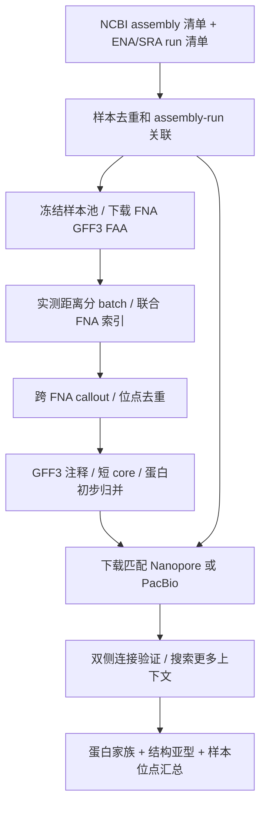

# Download → 合并 → 跨 FNA callout → Nanopore/PacBio 关联计划

版本：v2，2026-10-24（America/Los_Angeles）。状态：端到端执行计划，待分阶段实现。
GFF3 小试验置于附录，计划主体覆盖完整数据流程。

## 1. 目标与本轮决策

从多个 assembly 联合发现候选，允许同一家族在每个样本中只有一个位置；
用配套 Nanopore 或 PacBio 长读段检查连接，并寻找更多上下文。
主要分析 **core 严格 <2500 bp、主要包含 1 或 2 个完整蛋白编码基因** 的候选。
core 长度不包含 upstream/downstream。没有已知转座酶注释也保留。

本文把“core protein”解释为 **insertion 内编码的同源核心蛋白**；宿主核心基因只用于亲缘/正交位置判断。
这两个概念分别存储。先产生 protein family，再区分 insertion 架构，最后汇总各样本位点。
蛋白同源、同一 insertion 亚型、同一正交位点和独立插入事件不是同一计数单位。

这是独立扩展实验。现有单株 PILER/RepeatScout 基线及 CLI 行为不变，
不能把本计划描述为已经实现 pooled FNA 或 GFF3 输入模式。
与 [既有跨物种计划](PLAN_CROSS_SPECIES_LONG_READS.md) 并存；本计划具体化短片段和蛋白归并路线。

## 2. 端到端工作流和交付物

**元数据 link 在下载 FNA 前就建立；大体积 reads 在候选和优先级明确后分批下载。**
没有配套 reads 的 assembly 仍可用于发现，结果标记为 assembly-only。

| 阶段 | 工作 | 输入 | 交付物 |
|---|---|---|---|
| S0 | 整理清单与 link | NCBI assembly、既有 ENA ONT inventory、新增 PacBio 元数据 | assemblies、runs、assembly_run_links、去重表 |
| S1 | 冻结与下载 | 选定 accession.version 清单 | FNA/GFF3/FAA、reports、manifest、完整性报告 |
| S2 | 合并与分 batch | 核验后的 FNA、taxon、ANI/AF | catalog、batch/pair 表、contig 来源索引 |
| S3 | 跨 FNA callout | pair 表和 assembly 比对 | 原始 pair calls、去重 loci、U/core/D |
| S4 | 注释与初始归并 | loci、GFF3、FAA | 1/2 CDS 子集、复核表、蛋白初步家族、DNA seed 目录 |
| S5 | reads 下载、检索、审计 | 已核查的 run links 和 seed 目录 | 逐位点支持/冲突、新 read contexts |
| S6 | 最终归并与报告 | 蛋白、结构、位点、reads 证据 | 家族/结构目录、分层统计、U/core/D+CDS 图 |

这些是拟实现的工作单元，不是现有 CLI 命令。本计划先冻结接口和验收条件，再逐阶段实现。

### S0：完整清单先行

沿用已整理的 ONT inventory，补充 PacBio runs 和 NCBI assembly catalog。
每次检索记录日期、范围和条件；“本次未找到”不写成“不存在”。ENA/SRA 同一 run 的镜像不增加数据量。

| link 状态 | 所需证据 | 使用方式 |
|---|---|---|
| assembly_source_run | assembly/提交材料明确引用该 run | 优先使用，注明是否与组装使用同批 reads |
| biosample_matched | exact BioSample 匹配，无菌株或实验冲突 | 可进入候选下载队列，保留核查证据 |
| unresolved | 仅同项目、相似菌株名或元数据矛盾 | 不自动分配给 assembly |
| no_link_found | 本次查询没有找到配套 run | 保留 assembly-only 发现 |

筛选 genomic/WGS 数据；amplicon、RNA、混合宏基因组单列，不直接归给 isolate。
去重分别处理文件/run、BioSample、同菌株重复提交和近克隆；独立提交不自动等于独立背景。
同时报告 n_assemblies、n_unique_samples、n_annotated_samples、n_linked_ONT、n_linked_HiFi、n_projects。
**S0 验收：**每个关联和下载条目可回溯来源；未知、矛盾和无配套数据状态明确。

## 3. S1：FNA 数据库选择与批量下载

主来源采用 **NCBI Assembly，经 Datasets 批量获取**；优先有注释的 RefSeq，GenBank 补充缺失样本。
每个 accession.version 同时取得 genomic FNA、GFF3、protein FAA、assembly/sequence reports。
这几种文件在 [NCBI genome package 文档](https://www.ncbi.nlm.nih.gov/datasets/docs/v2/how-tos/genomes/download-genome/) 中有明确下载方式。
本次小试验使用同一 NCBI assembly HTTPS 目录；规模化采用冻结 accession 清单的批量包及可恢复下载。

每条 assembly 记录保存：accession.version、BioSample、BioProject、taxon_id、strain、
assembly level、注释来源/日期、全部 contig 的 accession.version/长度/序列 SHA256、文件 URL/哈希和抓取时间。
GCA/GCF 配对只有核对序列对应关系后才去重；不要仅删除 `NZ_` 前缀推断等价。
相同 BioSample 的重组装和重复提交不能增加独立样本数；异版本保留映射及选择理由。
无 GFF3 的 assembly 仍可用于序列发现，标注 annotation_missing；可选统一重注释须独立版本化。

候选大 batch 延续 **至少 100 个去重样本** 的要求，E. coli 等充分研究类群降低发现优先级。
这是数据池要求，不要求每个距离子组都达到 100；也不能把 100 个 assembly 自动当成 100 个配套长读段样本。
分别报告 n_unique_samples、n_assemblies、n_annotated_samples、n_linked_ONT_samples、n_linked_HiFi_samples 和项目数。
研究充分程度使用可追溯的人工标签/文献依据，样本少不等于研究少。环境字段保留缺失和来源，不从物种名推断环境。

### S1：批量下载与完整性

1. 按冻结 accession.version 清单获取 FNA、GFF3、FAA 和 assembly/sequence reports；染色体与质粒全部保留。
2. 大批量采用可恢复的 Datasets 下载；小批核验可用同一 NCBI assembly HTTPS 目录。原始 URL、检索时间和元数据快照归档。
3. 核对数据库提供的校验值、bytes 和本地 SHA256；逐 contig 核对 accession.version、长度与序列哈希。
4. 核对 GFF3 assembly/sequence-region 与 FNA，核对 GFF3 protein_id 与 FAA。注释日期和哈希单独冻结。
5. 没有注释的 assembly 标记 annotation_missing；仍可进入序列发现，重注释须另立版本。

按 accession/run/file 建立队列，保存 pending/downloading/verified/failed、重试次数和失败原因。
先写临时文件，完整校验后才进入可用状态；重跑只处理缺失或失败任务。
按服务支持情况续传，最终核对全文件；可解压或取得前缀不能代替完整存档验证。

先计算下载总字节和临时空间，按可配置的磁盘预算、并发数、batch 大小排队。
完整目录清单不意味着一次下载所有 reads。原始序列、reads 和大型比对留数据目录；
GitHub 存计划、脚本、manifest、校验和和小型结果。

**S1 验收：**所有使用的输入有固定版本/哈希；损坏、不完整或不匹配的数据不能进入 callout；失败不算零命中。

## 4. S2–S3：合并 FNA、分 batch、跨 FNA callout

“合并”要区分三件事：

1. **合并清单**：多个来源/批次的 assembly 去重后形成统一 catalog。
2. **联合发现输入**：建立带 sample_id/assembly_id/contig_id 的多 FASTA 或索引；每条 contig 独立，
   不串接不同 contig 的碱基，不把所有样本标成一个 sample。
3. **合并结果**：同位点先去重，再按蛋白家族和 insertion 结构亚型归并，不仅汇总单株结果。

候选大 batch 至少 100 个去重样本。taxon_id/属级关系先收拢零散名称，再按实测 ANI/AF 分距离子组；
100 样本要求不强制套到每个距离子组。建立近邻加代表样本的比较表，
用小子集全对全核查近邻选择的漏检，避免直接对数百个 FNA 全对全。
保留两侧 AF、计算版本、无距离返回和选择理由。

先实现可审计的 pairwise assembly gap 路线：

1. 对 pair 清单比对，寻找具备可靠双侧上下文的 `U-X-D` / `U-D` 差异。
   不要求 X 在单个 assembly 中先有多份拷贝。
2. 保存原始 pair call、query/ref 方向、core 坐标、CIGAR、竞争匹配、双侧定位和 caller 版本。
   presence/absence 不直接判定历史插入/删除方向。
3. 反向互补、复合 gap、重排、串联重复、contig 末端和 circular origin 单列；
   只有一段保守 flank 或不可定位的上下文保留 unresolved。
4. 按 sample/assembly/contig、core 重叠、边界和侧翼定位合并同位点的重复 pair calls，
   保留全部原始证据；不把相邻但独立的两个位点合并。
5. 导出每个 locus 的 U/core/D、方向和边界状态，再进入 GFF3 和长读段阶段。

已有单株发现结果可进入同一结果模型。多 FNA 重复/图方法作为独立补充路线，
用于没有可用 empty-site 对照的家族；不能把当前 CIGAR-gap 调用称为 PanGraph 图拓扑调用。

`skani_min_af >=40` 或 asm20 query 覆盖超过一半只是小面板的比较优先级线索，不是验证过的硬门槛。
45 对共享 10 个基因组，不能视作 45 个独立重复。低 AF/no-hit 保留对照；
高 AF 也不能替代位点局部共线性证据。

**S2 验收：**batch/pair 清单可复现，联合索引可追溯每条原 FNA，没有人为跨 contig 连接。
**S3 验收：**挑战案例覆盖单株一拷贝、跨株多背景、反向链、重复 pair、相邻位点、
同正交位点保留和错误重复匹配；候选数增加不单独视为改善。

## 5. S4：GFF3 注释与短 core 子集

根据 [NCBI GFF3 规范](https://www.ncbi.nlm.nih.gov/datasets/docs/v2/reference-docs/file-formats/annotation-files/about-ncbi-gff3/)
处理 1-based 坐标、同 ID 的多段特征和 Parent 层级；内部统一使用 0-based 半开坐标。
不以 GFF 行数当基因数，不以相同 protein_id 合并不同位点。记录 CDS phase、strand、partial、pseudo、exception、
RNA 和缺失蛋白；GFF ID 不是跨注释版本的稳定标识，必须绑定注释文件哈希。

主分析子集先采用本次严格条件；同时保留三类复核输出：边界相交、基因完整性异常、其它结构/基因数。
基因端点用于提示复核，**不自动把 DNA insertion 边界改成 CDS 边界**。
发现阶段保留全部候选；目标子集只是后处理视图，不改变上游原始输出。
小规模阶段将所有合格 CDS 从 FNA 翻译后核对 FAA；扩展 importer 前增加 phase、多 Parent、
跨原点、缺注释、重叠基因和注释版本变化的挑战样例。

## 6. S0/S5：link Nanopore/PacBio、下载及验证

关系应是 `assembly ↔ BioSample ↔ experiment/run ↔ file`，而非一个 FNA 固定对应一个 FASTQ。
优先记录 assembly 明确引用的 source reads；否则以同 BioSample 建立候选关联，进一步核对培养物/菌株和实验类型。
同一个 BioProject 或相似 strain 名只能进入待查列表；同 BioSample 也不自动证明是组装所用数据或独立重复。

下载清单来自 [ENA file report](https://ena-docs.readthedocs.io/en/latest/retrieval/programmatic-access/file-reports.html)，
保留 run、experiment、BioSample、platform、library strategy/source、文件 URL、bytes、MD5、
原始提交类型和 read-unit 说明。没有 ENA FASTQ 时再检查 SRA 原始提交文件；镜像同一 run 不算第二份数据。

ONT、PacBio HiFi/CCS、CLR/subreads 分开。PacBio 类型不能仅凭文件名或 Sequel 型号判断，
须记录元数据/提交文件证据；多个 subreads 不自动等于多个独立分子。
现有 [Sam8H1 HiFi pilot](../experiments/pacbio_hifi_pilot/README.md) 已报告单样本兼容性通过，
但其 assembly 来自同批 reads，且读名被改写后 ZMW 不可恢复；不能推广为全平台独立验证。

每个候选先用对应 DNA 序列/家族内已观察的 DNA 成员检索 reads，再检查两端连接、
唯一可定位侧翼、CIGAR 连续性和竞争比对。核心内部命中只算 homolog hit。
回到该 run 所属 assembly 定位；新增位置只有符合相同证据标准后才加入 locus 表，
无法定位时保存 read-context 记录，不伪造 assembly 坐标。每轮搜索固定种子库版本，新增成员复核后才进入下一轮。
完整存档下载后核对校验和；reads 前缀只用于可行性检查，不能估计缺失/频率/总拷贝数。

### S5：从关联表到 reads 下载和新增上下文

使用 S0 的已核查 links，优先下载有候选及代表性证据类别的样本，随后扩展。
ONT、HiFi/CCS、CLR/subreads 分开排队和配置；每个 run 保留来源，不无标识混合 FASTQ。
先完整校验文件，再处理重复文件/记录和可识别的同分子 reads。

S4 为每个候选保存 DNA 来源、蛋白组成和边界状态；初步蛋白分组后，
保留实际观察到的 DNA 成员作为 seed catalog，而不是只留一条共识。
每轮固定 seed 版本，记录检索范围与多重匹配上限。
只命中核心的记录仍是 homolog hit；新增上下文复核后才进入下一轮种子库，避免宽松匹配逐轮漂移。

**S5 验收：**逐位点支持能追溯 run 和支持单元；核心内部命中、竞争比对及同分子 subreads
不会被升级为独立双侧支持。覆盖/读长不足或前缀数据无命中不等于缺失。

## 7. S6：基于 core protein 的最终归并

采用三层模型：`protein_family → insertion_architecture → sample_locus`。

- **Protein family**：使用完整的核心 CDS 蛋白，记录双向覆盖、identity、蛋白长度和 domain 架构。
  首先核查保守聚类，再单独评估更远同源；宽松相似性得到的只是候选同源关系。
  [MMseqs2](https://github.com/soedinglab/MMseqs2/wiki) 可实现蛋白检索/聚类，覆盖模式和聚类模式必须冻结；
  不能通过 A–B、B–C 连通就默认为 A–C 属于同一种完整结构。
- **Insertion architecture**：一个或两个 CDS 的组合、顺序、相对方向、完整性、DNA core 边界和长度。
  共享一个蛋白但第二个基因不同的记录，先保留为同 protein family 下不同结构亚型。
  普通宿主同源基因不能仅因蛋白相似而成为 insertion family。
- **Sample locus**：记录该结构出现的样本、复制子、坐标、U/D 上下文和 reads 证据。
  同一正交位点在不同菌株的保留不算新的插入上下文；两个侧翼都须评估局部同源/共线关系。

保留一基因/两基因、完整/截短、核酸相似/蛋白远同源的分层结果。
无功能标签的蛋白参与结构比较；功能名不能替代同源分析。
相似性放宽的验收依据是边界和上下文仍可信、错误归并受控，不是“候选数变多”。
不会因某一蛋白功能标签提高其优先级；本阶段评估的是结构发现与归并质量。

## 8. 最小输出表及计数规则

| 表 | 关键字段/用途 |
|---|---|
| assemblies | assembly_id、BioSample、taxon_id、FNA/GFF/FAA 哈希、版本、QC |
| assembly_run_links | assembly_id、run、link_basis、source_evidence、read_type、assembly_consistency |
| pair_calls | pair、原始坐标、CIGAR/侧翼证据、caller 版本、失败状态 |
| loci | locus_id、sample/assembly/contig/start0/end0、core 哈希、边界状态、原始 call 列表 |
| locus_features | locus_id、注释快照、gene/CDS、protein_id、完整性、架构 |
| protein_membership | protein_instance_id、family_id、覆盖/identity、归并依据 |
| insertion_architectures | architecture_id、protein family 组合、方向、边界、成员 locus |
| read_support | locus/read_context_id、run、支持单元、双侧连接、竞争/冲突、独立性 |
| family_summary | protein family/architecture 分层统计样本数、正交上下文数、位点数、平台支持 |

家族、架构、BioSample、locus、read/molecule 分开计数。汇总表保留 excluded/review/no-hit/failed，
重复运行顺序不影响确定性 ID；新增数据不静默重写旧 family membership。

## 9. 实施顺序、验收与增量运行

| 顺序 | 要完成的工作 | 进入下一阶段的条件 |
|---|---|---|
| 第一阶段：清单和下载 | 实现 S0–S1，关联 ONT/PacBio/NCBI assembly；选定 ≥100 样本候选池，估算存储；先验证小份下载 | 去重分母、link 状态、版本/哈希及失败记录齐全 |
| 第二阶段：合并和 callout | 实现 S2–S4，在已核验小面板跑通跨 FNA、位点去重、GFF3 和初步蛋白目录；再扩大 assembly 数量 | 每个 locus 可追溯；同位点不因多个 pair 膨胀；不要求单株多拷贝 |
| 第三阶段：长读段接入 | 实现 S5，复用已有 ONT/HiFi 审计接口，下载匹配 runs，检查双侧连接与新增上下文 | 完整文件校验、read type/link evidence、竞争/冲突、读段或分子单位明确 |
| 第四阶段：最终归并和规模化 | 实现 S6，冻结 protein family/architecture 规则，扩展到 ≥100 样本数据池 | 家族、结构、样本、位点、上下文和 reads 分层统计，提供代表图和失败原因 |

每个阶段报告实际完成分母、配套 reads 数、磁盘/时间消耗。100 个 assembly 不自动等于 100 个有长读段的样本。
生产阈值由小面板和挑战对照校准；宽松距离/相似性独立记录，保留基线。
GFF3 边界复核是 S4 的一项工作，不替代总体下载清单、合并策略和 assembly–run 关联建设。

表结构冻结 schema_version，所有步骤记录输入哈希、命令、软件版本和状态。
相同输入可复跑；新增 assembly/run 仅触发相关下载、比较和审计。
受影响家族保留 membership 版本及拆分/合并记录，不静默覆盖旧结果。
missing、failed、unresolved 与 zero-hit 分开。

最终交付每个家族的：核心蛋白、1/2 CDS 架构、来源样本/环境、去重 locus、
不同正交上下文数、ONT/HiFi/CLR 支持状态及 U/core/D+CDS 图。
本文是实施计划，不表示这些模块已经上线，也不启动新的批量下载或集群任务。

## 附录：已有 GFF3 小试验，仅作为实施基础

详见 [试验、脚本和结果](../experiments/gff3_short_insertion_pilot/README.md)。
H16/H850 的同版本 FNA/GFF3/FAA 下载和校验已完成，7 条 contig 序列与冻结 SHA256 一致。

| 筛选/检查 | 结果 |
|---|---:|
| 原 assembly 差异候选 | 70 |
| core <2500 bp | 44 |
| 严格注释子集合格 | 14，均为 1 个完整 CDS |
| 需复核 | 30 |
| 边界与注释特征相交 | 25；与其他原因可重叠 |
| 完整包含 2 个 CDS 的记录 | 4，全部有其它复核原因 |
| 合格 CDS 从 FNA 翻译后与 FAA 一致 | 14/14 |

这支持采用 GFF3 做结构注释，也显示不能仅按“长度合适、内部有一个蛋白”认定完整 insertion。
主要问题是候选边界和基因边界的关系。25 个相交记录不等于 25 个假阳性：真实插入也可能打断宿主基因。
实施 S4 时须区分宿主基因被打断、候选 core 被截短、重叠基因和注释异常，不能一律删除或自动扩边。
14 个合格记录也可能包含普通 accessory gene，仍需多个不同上下文和 reads 证据。

本次仅重注释已有坐标；未重新进行 read 审计或蛋白聚类。
旧发现下限为 400 bp，因此 44 不覆盖所有 <2500 bp 候选，后续需单列更短片段的灵敏度测试。
未将此前 400–20000 bp 的候选产量或两个 run 的前缀 reads 结果解释为本目标的准确率。
